<picture>
  <source media="(prefers-color-scheme: dark)" srcset="assets/header-dark.svg">
  
</picture>

<picture>
  <source media="(prefers-color-scheme: dark)" srcset="assets/stack-dark.svg">
  
</picture>

<a href="https://github.com/wesper-01/decided">
<picture>
  <source media="(prefers-color-scheme: dark)" srcset="assets/projects-dark.svg">
  
</picture>
</a>

Photographs, cropped and converted to greyscale: <a href="https://commons.wikimedia.org/wiki/File:Silicon_chip_from_a_computer_laser_mouse_under_a_microscope_50%D1%85.jpg">silicon chip</a> by Alexander Klepnev (CC BY-SA 4.0), <a href="https://commons.wikimedia.org/wiki/File:Close-up_Hand_holding_dumbbell_in_gym.jpg">hand holding a dumbbell</a> by Nenad Stojkovic (CC BY 2.0), via Wikimedia Commons.
