<picture>
  <source media="(prefers-color-scheme: dark)" srcset="assets/header-dark.svg">
  
</picture>

### About
<!-- One or two lines. Who you are, in plain words. -->
20, from Morocco, living in Spain. Studying DAM (multiplatform app development). I like knowing how things work underneath.

### Now
<!-- What you're doing these weeks, and where it's going. -->
Teaching myself C++ and getting familiar with assembly, because reverse engineering is what pulls me in. Cybersecurity is where I want to end up.

<picture>
  <source media="(prefers-color-scheme: dark)" srcset="assets/trace-dark.svg">
  
</picture>

A real run: <a href="tools/trace/wesper.cpp">this program</a>, compiled with g++ and recorded one instruction at a time in gdb.

### Stack
<!-- Move things between columns as you get better at them. Keep it honest. -->
| Comfortable | Studying in DAM | Teaching myself |
| --- | --- | --- |
| Python | Java, HTML, CSS | C++, assembly |

### Past project
<!-- The one project worth pointing at, and what it was. -->
[TriageFlow](https://github.com/wesper-01/TriageFlow) sorts support emails into categories and drafts replies, using free AI models. It's discontinued, but it's the project I learned the most from. [The documentation](https://github.com/wesper-01/TriageFlow/blob/main/DOCUMENTATION.md) covers how it works.

### Also
<!-- Anything else: interests, languages. -->
I like taking games apart to see how they work. I speak Arabic, French and English, and I'm getting there with Spanish.
